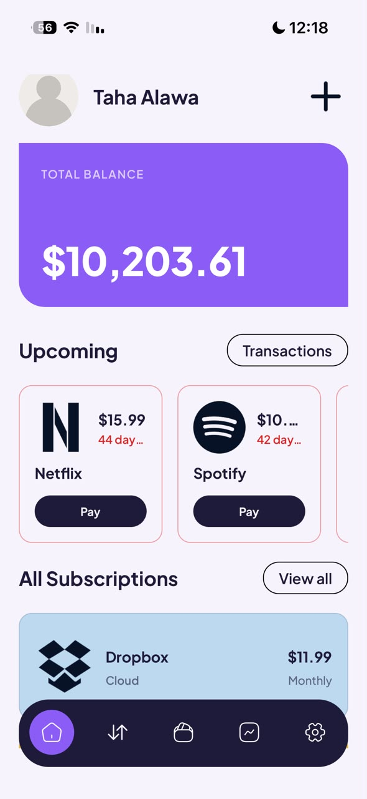
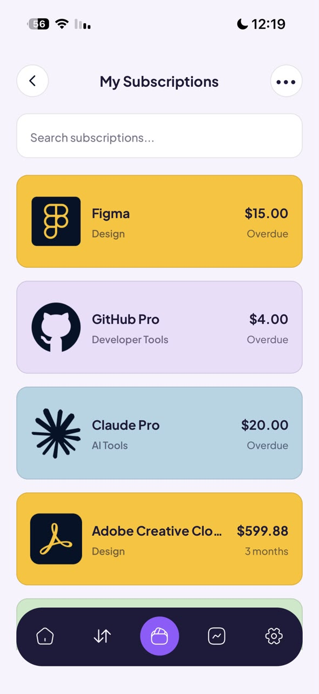
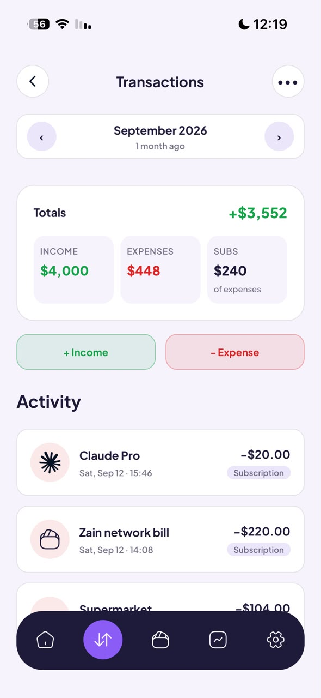
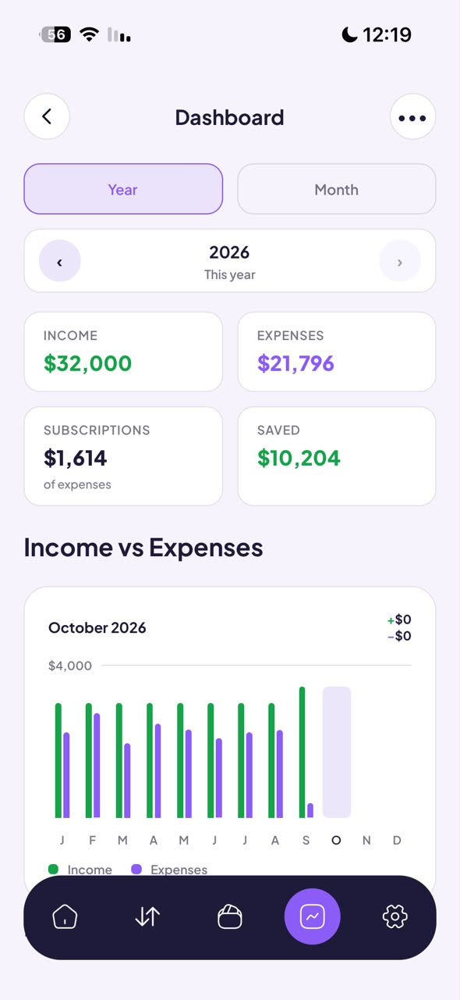
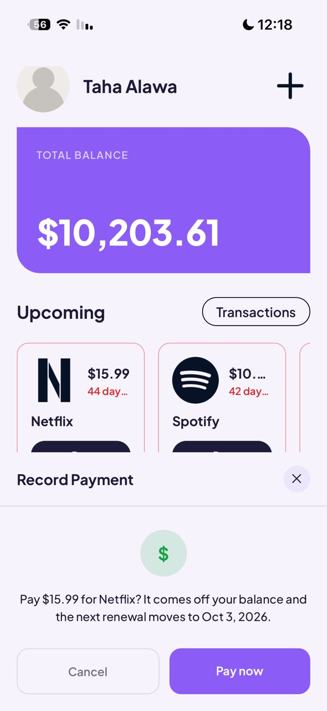
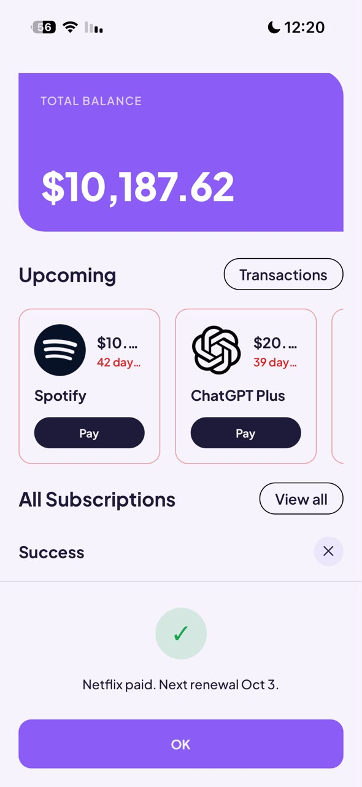
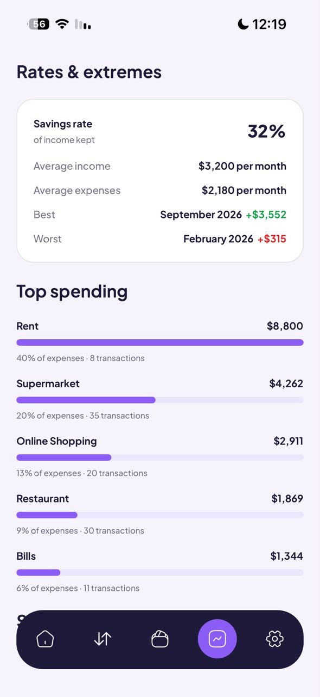
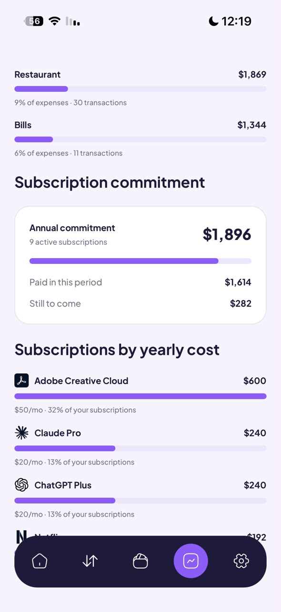

<div align="center">


# Subly

**Track your subscriptions, income and expenses, all in one place.**

Built with React Native and Expo · English & Arabic · iOS, Android and Web

</div>

---

## What it does

- **Balance at a glance:** your total balance updates with every transaction.
- **Subscriptions:** add Netflix, Spotify, Figma and others with a price, billing cycle and category.
- **Never miss a renewal:** upcoming payments are shown on the home screen, and one tap records the payment and moves the renewal date.
- **Transactions:** log income and expenses, browse them month by month, and see the totals.
- **Dashboard:** yearly and monthly charts, savings rate, top spending categories, and what your subscriptions cost per year.
- **Arabic & English:** full right-to-left layout for Arabic.
- **Currencies:** choose your currency in Settings, including the new Saudi Riyal sign.

## Screenshots

| Home | Subscriptions | Transactions | Dashboard |
| :---: | :---: | :---: | :---: |
|  |  |  |  |

| Pay a subscription | Payment recorded | Top spending | Yearly subscription cost |
| :---: | :---: | :---: | :---: |
|  |  |  |  |

### Demo video

▶️ [Watch the demo](docs/demo.mp4)

## Tech stack

| | |
| --- | --- |
| App | [Expo](https://expo.dev) SDK 57, React Native, Expo Router |
| Styling | NativeWind (Tailwind CSS) |
| Backend | Firebase Auth + Firestore |
| Languages | i18next (English / Arabic, RTL) |
| Analytics | PostHog |

## Run it locally

1. **Install the dependencies**

   ```bash
   npm install
   ```

2. **Create a `.env` file** in the project root with your Firebase web app config (Firebase console → Project settings → Your apps):

   ```env
   EXPO_PUBLIC_FIREBASE_API_KEY=
   EXPO_PUBLIC_FIREBASE_AUTH_DOMAIN=
   EXPO_PUBLIC_FIREBASE_PROJECT_ID=
   EXPO_PUBLIC_FIREBASE_STORAGE_BUCKET=
   EXPO_PUBLIC_FIREBASE_MESSAGING_SENDER_ID=
   EXPO_PUBLIC_FIREBASE_APP_ID=

   # Optional: analytics
   POSTHOG_PROJECT_TOKEN=
   POSTHOG_HOST=
   ```

3. **Start the app**

   ```bash
   npx expo start
   ```

   Scan the QR code with **Expo Go** on your phone, or press `w` to open it in the browser.

## Project structure

```
src/
├── app/        # Screens and routes (Expo Router)
├── features/   # One folder per feature: Auth, Home, Subscriptions,
│               # Transactions, Insights, Balance, Settings
├── core/       # Shared components, hooks, stores, i18n, theme, utils
├── layouts/    # Root, auth and tab layouts
└── assets/     # Fonts, icons, images, translations
```

## Useful scripts

| Command | What it does |
| --- | --- |
| `npm start` | Start the dev server |
| `npm run typecheck` | Check TypeScript types |
| `npm run lint` | Run ESLint |
| `npm run locales:audit` | Find missing or unused translation keys |
